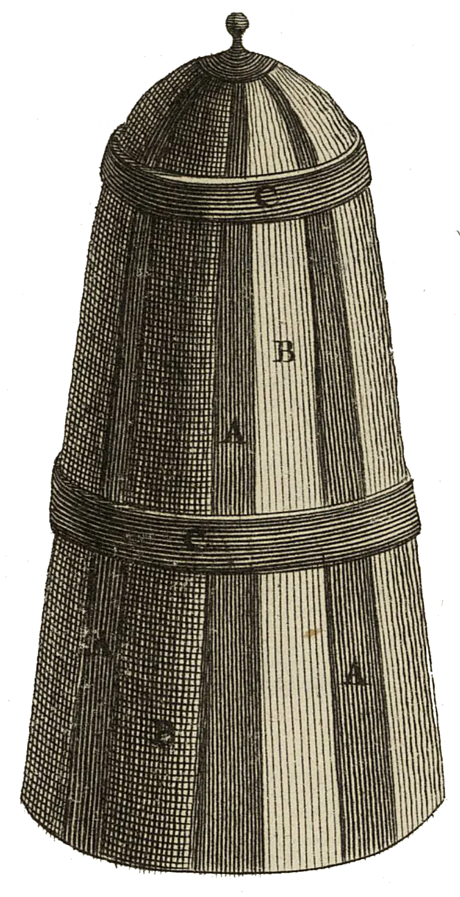

<div align="center" id="head">


<table>
<tr>
<td></td>
<td align="left">
<h1 style="margin:0">PlanRecorder</h1>
<p style="margin:0.25em 0 0"><strong>Kalenderbezogene Audionotizen</strong><br/>Android · Kalender · Opus · Obsidian</p>
</td>
</tr>
</table>

<a href="https://atelier.atechnologie.fr/" title="l'Atelier – Verein für Buchherstellung und Forschungswerkzeuge"></a>  
<sub>Entwickelt von <a href="https://atelier.atechnologie.fr/">l'Atelier</a> — Buchherstellung und Forschungswerkzeuge (EHESS)</sub>

<p>
🇫🇷 <a href="README.md">Français</a> ·
🇬🇧 <a href="README.en.md">English</a> ·
🇩🇪 <a href="README.de.md"><b>Deutsch</b></a> ·
🇪🇸 <a href="README.es.md">Español</a>
</p>

<p>
<a href="https://atelier.atechnologie.fr/"></a>
<a href="https://github.com/Atelier-Recherche/PlanRecorder"></a>
</p>

</div>

---

## 📸 Vorschau

| Aufnahme | Einstellungen |
| :---: | :---: |
|  |  |

---
## 📖 Über

Fork von [AudioRecorder](https://github.com/Dimowner/AudioRecorder) (v2.5) für **kalenderbezogene Audionotizen** (DAVx⁵ / Android-Kalender).

| | |
|---|---|
| Application ID | `com.planrecorder` (Debug: `com.planrecorder.debug`) |
| Lizenz | Apache 2.0 (Basis AudioRecorder) |
| Icon | [Lucide mic-signal](https://lucide.dev/icons/mic-signal) (ISC) — Danke Lucide |

---

## ✨ Funktionen

1. **Aktuelles Kalenderereignis** via `CalendarContract` beim Start der Aufnahme
2. Konfigurierbarer **Quellkalender** (oder alle Kalender)
3. Konfigurierbare Ordner-/Datei-**Patterns** mit antippbaren Tags (`[id]`, `[ue]`, Datum/Uhrzeit…)
4. **SAF-Export** in einen einmal gewählten Wurzelordner
5. **Opus** + Voreinstellung **Filter for voices**
6. Optionale **KI-Rauschunterdrückung (DPDFNet baseline)**, 16 kHz mono (ausschließlich zum Sprachfilter)
7. **Benutzerdefinierte Identifikatoren** (`UE:1+`, `MATH:3`…) + Liste bereits gesehener IDs
8. Optionale **Live-AGC** und **Normalisierung** beim Export
9. **Widget „aktuelle Sitzung“** und **Erinnerung X Min.** vor dem Termin
10. **Marker** während der Aufnahme → Markdown im Obsidian-Stil  
    `[[datei.opus#t=508|08:28]] sitzungsbeginn`

---

## 🧠 Intelligentes Ordner-Matching

Wenn das Pattern `UE581 session croquette` ergibt, aber bereits `UE581 session croquette et tech` existiert, **verwendet PlanRecorder den bestehenden Ordner erneut** (und umgekehrt), solange die Kennung übereinstimmt.

---

## ❓ Kein Ereignis / Mehrdeutigkeit

- Vorschläge aus vorhandenen ID-Ordnern + gemerkten IDs
- Vorausfüllung im Abschlussdialog editierbar

---

## 🏷 Pattern-Tags

| Tag | Bedeutung |
|-----|---------|
| `[calendar]` | Anzeigename des Kalenders |
| `[title]` | Vollständiger Ereignistitel |
| `[title_rest]` | Titel ohne Identifikator-Präfix |
| `[id]` / `[ue]` | Extrahierte ID (`UE323`, …) |
| `[NN]` / `[nn]` | Sitzungsnummer (01… / 1…) |
| `[dd]` `[mm]` `[yy]` `[yyyy]` | Datum |
| `[HH]` `[MM]` `[SS]` | Uhrzeit (`[MM]` = Minuten, `[mm]` = Monat) |

Standards: Ordner `[calendar]/[id] [title_rest]` · Datei `[NN]-T[HH][MM][SS]-[dd][mm][yy]-[id]`

---

## 🛠 Build / Installation

```bash
./gradlew :app:assembleDebugConfigDebug
adb install -r app/build/outputs/apk/debugConfig/debug/app-debugConfig-debug.apk
```

---

## ▶️ Erste Einrichtung

1. **Settings → PlanRecorder**
2. **Exportordner** wählen (SAF)
3. **Kalender** wählen (z. B. DAVx⁵)
4. Patterns / Identifikatorregeln anpassen
5. Optional: Filter for voices **oder** KI-Rauschunterdrückung (DPDFNet), AGC, Normalisierung, Erinnerung
6. **Kalender** freigeben (+ Benachrichtigungen für Erinnerungen)
7. Während eines Ereignisses aufnehmen, Abschlussdialog bestätigen

---

## 📦 In ein neues GitHub-Repository veröffentlichen

```bash
# 1. Repository erstellen (GitHub-Konto via gh verbunden)
gh repo create PlanRecorder --public --source=. --remote=origin --description "Calendar-aware audio notes for sessions (fork of AudioRecorder)"

# 2. Branch pushen
git push -u origin HEAD

# Oder, falls origin bereits existiert:
# git remote add origin https://github.com/<du>/PlanRecorder.git
# git push -u origin HEAD
```

Upstream AudioRecorder für Merges behalten:

```bash
git remote add upstream https://github.com/Dimowner/AudioRecorder.git   # falls nötig
git fetch upstream
git merge upstream/master
```

Java-Packages bleiben `com.dimowner.audiorecorder…`, um Merges zu erleichtern; nur `applicationId` / App-Label sind PlanRecorder.

---

## 🙏 Credits

- [AudioRecorder](https://github.com/Dimowner/AudioRecorder) — Dmytro Ponomarenko (Apache 2.0)
- [DPDFNet](https://github.com/ceva-ip/DPDFNet) / [Ceva-IP models](https://huggingface.co/Ceva-IP/DPDFNet) — Live-Rauschunterdrückung (Apache 2.0); Details in [THIRD_PARTY_NOTICES.md](THIRD_PARTY_NOTICES.md)
- Icon [mic-signal](https://lucide.dev/icons/mic-signal) — [Lucide Icons](https://lucide.dev) (ISC)

---

## 🌐 Links

- 🌐 [l’Atelier](https://atelier.atechnologie.fr/)
- 📦 [GitHub-Repository](https://github.com/Atelier-Recherche/PlanRecorder)
