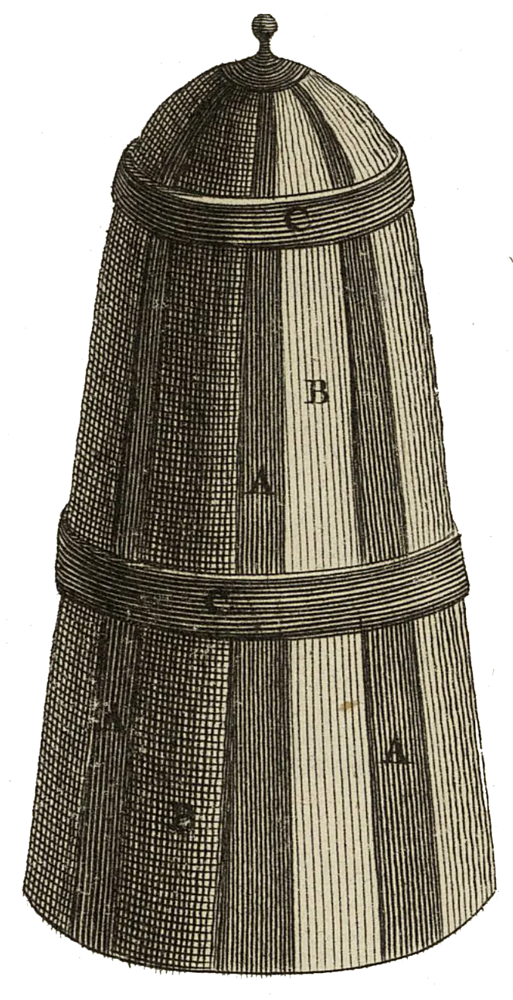

<div align="center" id="head">


<table>
<tr>
<td></td>
<td align="left">
<h1 style="margin:0">PlanRecorder</h1>
<p style="margin:0.25em 0 0"><strong>Calendar-aware audio notes</strong><br/>Android · calendar · Opus · Obsidian</p>
</td>
</tr>
</table>

<a href="https://atelier.atechnologie.fr/" title="l'Atelier – book-making and research tools association"></a>  
<sub>Developed by <a href="https://atelier.atechnologie.fr/">l'Atelier</a> — book-making and research tools (EHESS)</sub>

<p>
🇫🇷 <a href="README.md">Français</a> ·
🇬🇧 <a href="README.en.md"><b>English</b></a> ·
🇩🇪 <a href="README.de.md">Deutsch</a> ·
🇪🇸 <a href="README.es.md">Español</a>
</p>

<p>
<a href="https://atelier.atechnologie.fr/"></a>
<a href="https://github.com/Atelier-Recherche/PlanRecorder"></a>
</p>

</div>

---

## 📸 Preview

| Recording | Settings |
| :---: | :---: |
|  |  |

---
## 📖 About

Fork of [AudioRecorder](https://github.com/Dimowner/AudioRecorder) (v2.5) for **calendar-aware session notes** (DAVx⁵ / Android calendar).

| | |
|---|---|
| Application ID | `com.planrecorder` (debug: `com.planrecorder.debug`) |
| License | Apache 2.0 (based on AudioRecorder) |
| Icon | [Lucide mic-signal](https://lucide.dev/icons/mic-signal) (ISC) — thanks Lucide |

---

## ✨ Features

1. **Active calendar event** lookup via `CalendarContract` when recording starts
2. **Source calendar** filter (or all calendars)
3. Configurable folder / file **patterns** with tappable tags (`[id]`, `[ue]`, date/time…)
4. **SAF export** to a one-time chosen root folder
5. **Opus** + **Filter for voices** preset
6. Optional **AI noise reduction (DPDFNet baseline)**, 16 kHz mono (exclusive with the voice filter)
7. **Custom identifiers** (`UE:1+`, `MATH:3`…) + remembered ID list
8. Optional **live AGC** and **normalization** on export
9. **Current-session widget** and **reminder X minutes** before the slot
10. **Markers** while recording → Obsidian-style Markdown  
    `[[file.opus#t=508|08:28]] start of session`

---

## 🧠 Smart folder matching

If the pattern yields `UE581 session croquette` but `UE581 session croquette and tech` already exists under the SAF root, PlanRecorder **reuses the existing folder** (and the reverse), as long as the identifier matches.

---

## ❓ No event / ambiguity

- suggestions from existing ID folders + remembered IDs
- prefill is editable in the end-of-recording dialog

---

## 🏷 Pattern tags

| Tag | Meaning |
|-----|---------|
| `[calendar]` | Calendar display name |
| `[title]` | Full event title |
| `[title_rest]` | Title without identifier prefix |
| `[id]` / `[ue]` | Extracted id (`UE323`, …) |
| `[NN]` / `[nn]` | Session number (01… / 1…) |
| `[dd]` `[mm]` `[yy]` `[yyyy]` | Date |
| `[HH]` `[MM]` `[SS]` | Time (`[MM]` = minutes, `[mm]` = month) |

Defaults: folder `[calendar]/[id] [title_rest]` · file `[NN]-T[HH][MM][SS]-[dd][mm][yy]-[id]`

---

## 🛠 Build / install

```bash
./gradlew :app:assembleDebugConfigDebug
adb install -r app/build/outputs/apk/debugConfig/debug/app-debugConfig-debug.apk
```

---

## ▶️ First-time setup

1. **Settings → PlanRecorder**
2. Pick the **export folder** (SAF)
3. Pick the **calendar** (e.g. DAVx⁵)
4. Adjust patterns / identifier rules
5. Optional: Filter for voices **or** AI noise reduction (DPDFNet), AGC, normalize, reminder
6. Grant **Calendar** (+ notifications for reminders)
7. Record during an event, confirm the save dialog

---

## 📦 Publish to a new GitHub repository

```bash
# 1. Create the repository (GitHub account connected via gh)
gh repo create PlanRecorder --public --source=. --remote=origin --description "Calendar-aware audio notes for sessions (fork of AudioRecorder)"

# 2. Push the branch
git push -u origin HEAD

# Or, if origin already exists:
# git remote add origin https://github.com/<you>/PlanRecorder.git
# git push -u origin HEAD
```

Keep upstream AudioRecorder for merges:

```bash
git remote add upstream https://github.com/Dimowner/AudioRecorder.git   # if needed
git fetch upstream
git merge upstream/master
```

Java packages stay `com.dimowner.audiorecorder…` to ease merges; only `applicationId` / app label are PlanRecorder.

---

## 🙏 Credits

- [AudioRecorder](https://github.com/Dimowner/AudioRecorder) — Dmytro Ponomarenko (Apache 2.0)
- [DPDFNet](https://github.com/ceva-ip/DPDFNet) / [Ceva-IP models](https://huggingface.co/Ceva-IP/DPDFNet) — live noise reduction (Apache 2.0); details in [THIRD_PARTY_NOTICES.md](THIRD_PARTY_NOTICES.md)
- Icon [mic-signal](https://lucide.dev/icons/mic-signal) — [Lucide Icons](https://lucide.dev) (ISC)

---

## 🌐 Links

- 🌐 [l’Atelier](https://atelier.atechnologie.fr/)
- 📦 [GitHub repository](https://github.com/Atelier-Recherche/PlanRecorder)
