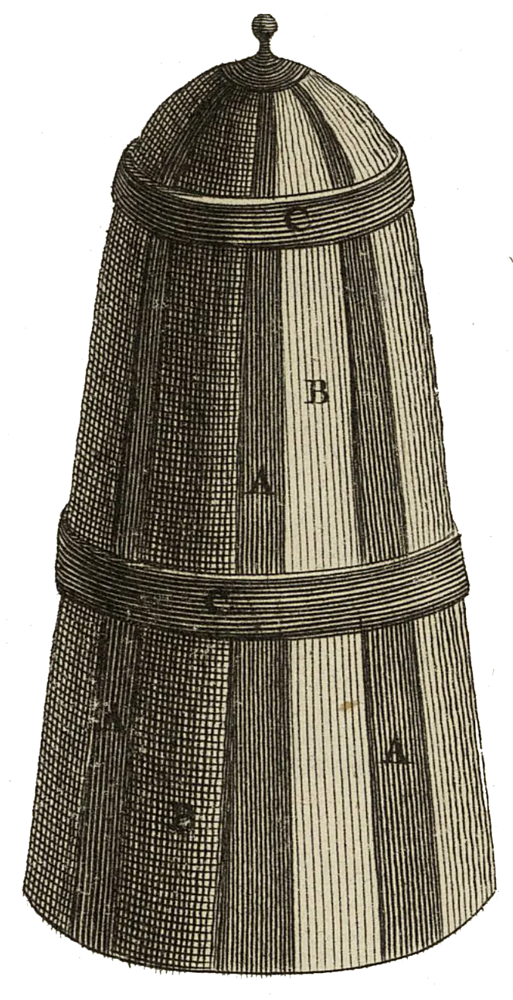

<div align="center" id="head">


<table>
<tr>
<td></td>
<td align="left">
<h1 style="margin:0">PlanRecorder</h1>
<p style="margin:0.25em 0 0"><strong>Notas de audio por evento de calendario</strong><br/>Android · calendario · Opus · Obsidian</p>
</td>
</tr>
</table>

<a href="https://atelier.atechnologie.fr/" title="l'Atelier – asociación de fabricación de libros y herramientas de investigación"></a>  
<sub>Desarrollado por <a href="https://atelier.atechnologie.fr/">l'Atelier</a> — fabricación de libros y herramientas de investigación (EHESS)</sub>

<p>
🇫🇷 <a href="README.md">Français</a> ·
🇬🇧 <a href="README.en.md">English</a> ·
🇩🇪 <a href="README.de.md">Deutsch</a> ·
🇪🇸 <a href="README.es.md"><b>Español</b></a>
</p>

<p>
<a href="https://atelier.atechnologie.fr/"></a>
<a href="https://github.com/Atelier-Recherche/PlanRecorder"></a>
</p>

</div>

---

## 📸 Vista previa

| Grabación | Ajustes |
| :---: | :---: |
|  |  |

---
## 📖 Acerca de

Fork de [AudioRecorder](https://github.com/Dimowner/AudioRecorder) (v2.5) para **tomar notas de audio clasificadas por evento de calendario** (DAVx⁵ / calendario Android).

| | |
|---|---|
| Application ID | `com.planrecorder` (debug: `com.planrecorder.debug`) |
| Licencia | Apache 2.0 (base AudioRecorder) |
| Icono | [Lucide mic-signal](https://lucide.dev/icons/mic-signal) (ISC) — gracias Lucide |

---

## ✨ Funciones

1. **Evento en curso** vía `CalendarContract` al iniciar la grabación
2. **Calendario de origen** configurable (o todos los calendarios)
3. **Patrones** de carpeta / archivo con etiquetas pulsables (`[id]`, `[ue]`, fecha/hora…)
4. **Exportación SAF** a una carpeta raíz elegida una vez
5. **Opus** + preajuste **Filter for voices**
6. **Reducción de ruido IA (DPDFNet baseline)** opcional, 16 kHz mono (excluyente del filtro de voz)
7. **Identificadores personalizados** (`UE:1+`, `MATH:3`…) + lista de IDs ya vistos
8. **AGC en vivo** y **normalización** en la exportación (opciones)
9. **Widget «sesión en curso»** y **recordatorio X min** antes del hueco
10. **Marcadores** durante la grabación → Markdown estilo Obsidian  
    `[[archivo.opus#t=508|08:28]] inicio de sesión`

---

## 🧠 Emparejamiento inteligente de carpetas

Si el patrón produce `UE581 session croquette` pero ya existe `UE581 session croquette et tech`, PlanRecorder **reutiliza la carpeta existente** (y a la inversa), mientras el identificador coincida.

---

## ❓ Sin evento / ambigüedad

- sugerencias entre carpetas ID ya presentes + IDs memorizados
- prerellenado editable en el diálogo final

---

## 🏷 Etiquetas de patrón

| Tag | Significado |
|-----|---------|
| `[calendar]` | Nombre mostrado de la agenda |
| `[title]` | Título completo |
| `[title_rest]` | Título sin el prefijo identificador |
| `[id]` / `[ue]` | Identificador extraído (`UE323`, …) |
| `[NN]` / `[nn]` | Número de sesión (01… / 1…) |
| `[dd]` `[mm]` `[yy]` `[yyyy]` | Fecha |
| `[HH]` `[MM]` `[SS]` | Hora (`[MM]` = minutos, `[mm]` = mes) |

Valores por defecto: carpeta `[calendar]/[id] [title_rest]` · archivo `[NN]-T[HH][MM][SS]-[dd][mm][yy]-[id]`

---

## 🛠 Build / instalación

```bash
./gradlew :app:assembleDebugConfigDebug
adb install -r app/build/outputs/apk/debugConfig/debug/app-debugConfig-debug.apk
```

---

## ▶️ Primera utilización

1. **Settings → PlanRecorder**
2. Elegir la **carpeta de exportación** (SAF)
3. Elegir el **calendario** (p. ej. DAVx⁵)
4. Ajustar patrones / reglas de identificador
5. Opcional: Filter for voices **o** reducción de ruido IA (DPDFNet), AGC, normalización, recordatorio
6. Conceder **Calendario** (+ notificaciones para recordatorios)
7. Grabar durante un evento, validar el diálogo final

---

## 📦 Publicar en un nuevo repositorio GitHub

```bash
# 1. Crear el repositorio (cuenta GitHub conectada vía gh)
gh repo create PlanRecorder --public --source=. --remote=origin --description "Calendar-aware audio notes for sessions (fork of AudioRecorder)"

# 2. Empujar la rama
git push -u origin HEAD

# O, si origin ya existe:
# git remote add origin https://github.com/<tu>/PlanRecorder.git
# git push -u origin HEAD
```

Mantener el upstream AudioRecorder para los merges:

```bash
git remote add upstream https://github.com/Dimowner/AudioRecorder.git   # si hace falta
git fetch upstream
git merge upstream/master
```

Los paquetes Java siguen siendo `com.dimowner.audiorecorder…` para facilitar los merges; solo el `applicationId` / la etiqueta son PlanRecorder.

---

## 🙏 Créditos

- [AudioRecorder](https://github.com/Dimowner/AudioRecorder) — Dmytro Ponomarenko (Apache 2.0)
- [DPDFNet](https://github.com/ceva-ip/DPDFNet) / [Ceva-IP models](https://huggingface.co/Ceva-IP/DPDFNet) — reducción de ruido en vivo (Apache 2.0); detalles en [THIRD_PARTY_NOTICES.md](THIRD_PARTY_NOTICES.md)
- Icono [mic-signal](https://lucide.dev/icons/mic-signal) — [Lucide Icons](https://lucide.dev) (ISC)

---

## 🌐 Enlaces

- 🌐 [l’Atelier](https://atelier.atechnologie.fr/)
- 📦 [Repositorio GitHub](https://github.com/Atelier-Recherche/PlanRecorder)
